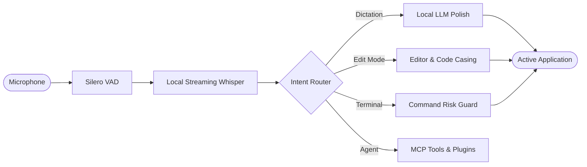

# Cadence

> **Free, open-source, on-device AI voice interface and developer engine.**

[](LICENSE)
[](https://golang.org)
[](docs/INSTALL.md)
[](https://github.com/AdeshDeshmukh/cadence/releases)
[](https://github.com/AdeshDeshmukh/cadence/actions/workflows/ci.yml)
[](https://github.com/AdeshDeshmukh/cadence/actions/workflows/security.yml)
[](CONTRIBUTING.md)

Cadence is a **local-first, cross-platform voice interface and developer engine** that goes far beyond standard dictation. Speak naturally — Cadence understands whether you want to dictate text, edit code, execute shell commands, manage meetings, control your desktop, or run an autonomous AI agent.

- **100% On-Device & Private:** Whisper ASR, Silero VAD, and local LLMs run completely on your machine. Zero mandatory accounts, zero cloud dependencies, zero audio or transcript logging without explicit opt-in.
- **Cross-Platform:** Native audio capture, keyboard automation, and background service management across **macOS** (CoreAudio, Launchd, Universal arm64/x86_64), **Linux** (PulseAudio, PipeWire, Systemd), and **Windows** (WASAPI, Named Pipes, Win32).
- **Developer First:** AST code casing, terminal context awareness, three-tier command safety guards, Git commit/PR generation, and Model Context Protocol (MCP) server for Claude Code, Cursor, and Antigravity.

---

## Documentation

- **[Installation Guide](docs/INSTALL.md):** Quickstart via Homebrew, macOS Universal Binaries, `.deb`, `.rpm`, Windows installer, and source builds.
- **[System Architecture](docs/ARCHITECTURE.md):** Deep dive into audio capture, Silero VAD, streaming Whisper, IPC, process supervisor, and security models.
- **[CLI Reference](docs/CLI_REFERENCE.md):** Exhaustive command reference for all 35+ commands, flags, and subcommands.
- **[Plugin SDK](docs/PLUGIN_SDK.md):** Manifest specification, hook lifecycles, and sandboxed WASM tool creation.

---

## Quick Start

### macOS (Homebrew)
```bash
brew tap AdeshDeshmukh/cadence
brew install cadence
brew services start cadence
```

### Linux (Debian / Ubuntu)
```bash
curl -LO https://github.com/AdeshDeshmukh/cadence/releases/latest/download/cadence_1.0.0_amd64.deb
sudo dpkg -i cadence_1.0.0_amd64.deb
systemctl --user enable --now cadenced.service
```

### Windows (PowerShell)
```powershell
irm https://github.com/AdeshDeshmukh/cadence/releases/latest/download/install.ps1 | iex
```

### Diagnose & Verify
```bash
cadence doctor
```

---

## Architecture Overview



---

## Feature Comparison

| Capability | Wispr Flow | Superwhisper | **Cadence v1.0.0** |
|---|---|---|---|
| macOS (Universal arm64 + x86_64) | ✅ | ✅ | ✅ |
| Linux (PulseAudio / PipeWire / Systemd) | ❌ | ❌ | ✅ |
| Windows (WASAPI / Win32 / Named Pipe) | ❌ | ❌ | ✅ |
| Local On-Device ASR | ✅ | ✅ | ✅ |
| Real-Time Streaming Speculation | ✅ | ❌ | ✅ |
| Natural Voice Text & Code Editing | ✅ | ❌ | ✅ |
| Developer Mode (IDE + Terminal Context) | ❌ | ❌ | ✅ |
| Three-Tier Shell Safety Guard | ❌ | ❌ | ✅ |
| Autonomous Agent Loop & MCP Server | ❌ | ❌ | ✅ |
| Meeting Diarization & Vector Knowledge Base | ❌ | ❌ | ✅ |
| Pure-Go CGO-Free SQLite Storage | ❌ | ❌ | ✅ |
| System Keychain Secret Storage | ❌ | ❌ | ✅ |
| Package Ecosystem (.deb, .rpm, brew, exe) | ❌ | ❌ | ✅ |
| Fully Open Source | ❌ | ❌ | ✅ Apache 2.0 |

---

## Contributing

Cadence is built in public by a passionate open-source community. Contributions, bug reports, and suggestions are welcome!

- Read [CONTRIBUTING.md](CONTRIBUTING.md) to set up your local development environment.
- Explore open issues labeled [`good-first-issue`](https://github.com/AdeshDeshmukh/cadence/labels/good-first-issue).
- Review our [Code of Conduct](CODE_OF_CONDUCT.md).

---

## License

Licensed under the Apache License, Version 2.0. See [LICENSE](LICENSE) for details.

*Built with ❤️ by [Adesh Deshmukh](https://github.com/AdeshDeshmukh) and the open-source community.*
