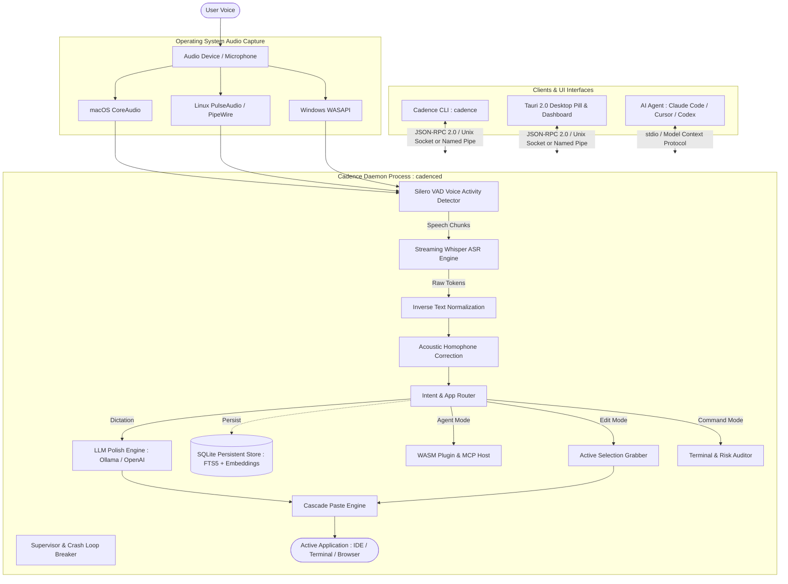

# Cadence Architecture & System Design

Cadence is an on-device, local-first AI voice interface and developer engine. It translates natural spoken language into precise text, code edits, terminal executions, or multi-step agent actions without transmitting audio or transcripts to third-party cloud servers.

---

## 1. System Topology

Cadence is structured as a modular client-daemon architecture communicating over local inter-process communication (IPC).



---

## 2. Core Subsystems

### 2.1 Audio Capture & Voice Activity Detection (VAD)
- **Cross-Platform Drivers:**
  - macOS: Native CoreAudio HAL stream listener.
  - Linux: PulseAudio simple stream falling back to PipeWire.
  - Windows: Direct WASAPI loopback and microphone endpoint capture.
- **Silero VAD:** Processes 16kHz mono audio in 32ms frames (512 samples) with a low-memory recurrent neural network to discard ambient background noise and detect speech onset and termination with sub-30ms latency.

### 2.2 Streaming ASR Engine
- **Local Whisper Inference:** Integrates quantized Whisper models (Tiny, Base, Small, Medium) running locally via Metal (macOS), CUDA/ROCm, or CPU AVX2/NEON.
- **Speculative Streaming Accumulator:** Continuously decodes partial speech windows, differentiating confirmed prefix text from speculative suffix tokens for real-time visual feedback in the desktop pill overlay.

### 2.3 Intent Routing & Context Engine
- **Active Window Detection:** Inspects foreground application metadata (bundle ID on macOS, X11/Wayland window properties on Linux, active process on Windows) to classify app category (`code`, `terminal`, `chat`, `document`).
- **Mode Dispatcher:**
  - **Dictate Mode:** Direct transcript cleanup, punctuation, and contextual formatting.
  - **Edit Mode:** Captures selected text from the foreground editor via accessibility APIs or simulated clipboard copy, parses spoken instructions (e.g., "replace user with customer"), and applies diffs.
  - **Command Mode:** Classifies intent as shell execution, system control (volume, screenshots, app launching), or Git actions.
  - **Agent Mode:** Autonomous multi-step tool invocation loop executing FS, Git, and web queries.

### 2.4 Code Casing & AST Formatting
- **Identifier Transformations:** Automatically formats identifiers into `snake_case`, `camelCase`, `PascalCase`, `kebab-case`, or `SCREAMING_SNAKE_CASE` based on detected programming language (Go, Python, TypeScript, Rust, C++).
- **Docstring Generator:** Generates language-idiomatic docstrings and comment headers matching language standards.

### 2.5 Security & Risk Classification
- **Three-Tier Command Classification:**
  - `Safe`: Read-only queries (`git status`, `ls`, `grep`, `pwd`). Auto-approved under relaxed policies.
  - `Risky`: State-modifying operations (`git commit`, `npm install`, `docker run`). Displays dry-run preview and interactive confirmation.
  - `Destructive`: Permanent data removal (`rm -rf`, `git push --force`, `drop database`). Always requires explicit user confirmation.
- **Keyring Secret Storage:** API keys and credentials are encrypted using the native OS keychain (macOS Keychain, Linux Secret Service / DBus, Windows Credential Manager).
- **Model Integrity Verification:** Cryptographic SHA256 checksums verify ML model weights before loading to prevent supply-chain tampering.

### 2.6 Persistence & Knowledge Base
- **Pure-Go SQLite:** Uses CGO-free modernc.org/sqlite database with SQLite FTS5 full-text search.
- **Vector Embeddings:** Vector indexing supporting on-device semantic search and related session discovery across meetings, notes, and dictations.

### 2.7 Supervisor, Crash Recovery & OS Services
- **Process Supervisor:** Wraps the daemon runtime with exponential backoff restart loops and a sliding-window circuit breaker (`ErrCrashLoopDetected`) to prevent CPU thrashing.
- **Crash Telemetry:** Abnormal terminations capture stack traces, active goroutine counts, and memory allocations to `~/.local/state/cadence/crashes/<id>.json`.
- **Session Recovery:** Dangling or uncommitted recording sessions from terminated processes are recovered and restored on startup.
- **Native OS Services:** Launchd agent plist generation (`~/Library/LaunchAgents/io.cadence.cadenced.plist`) on macOS and Systemd user units (`~/.config/systemd/user/cadenced.service`) on Linux.

---

## 3. IPC Protocol Specification

The Cadence daemon exposes a JSON-RPC 2.0 interface:
- **macOS / Linux:** UNIX domain socket at `$CADENCE_SOCK_PATH` (defaults to `~/.cache/cadence/cadenced.sock`).
- **Windows:** Named pipe at `\\.\pipe\cadenced`.

### Standard Frame Layout
```json
{
  "jsonrpc": "2.0",
  "id": 1,
  "method": "dictate_start",
  "params": {
    "mode": "code",
    "profile": "developer"
  }
}
```

### Standard Response
```json
{
  "jsonrpc": "2.0",
  "id": 1,
  "result": {
    "status": "recording",
    "session_id": "sess-1795254921"
  }
}
```
